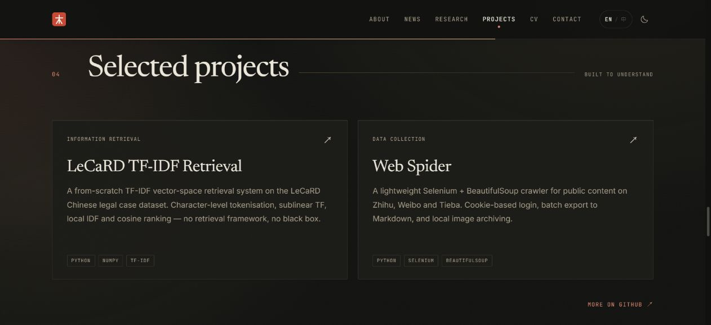
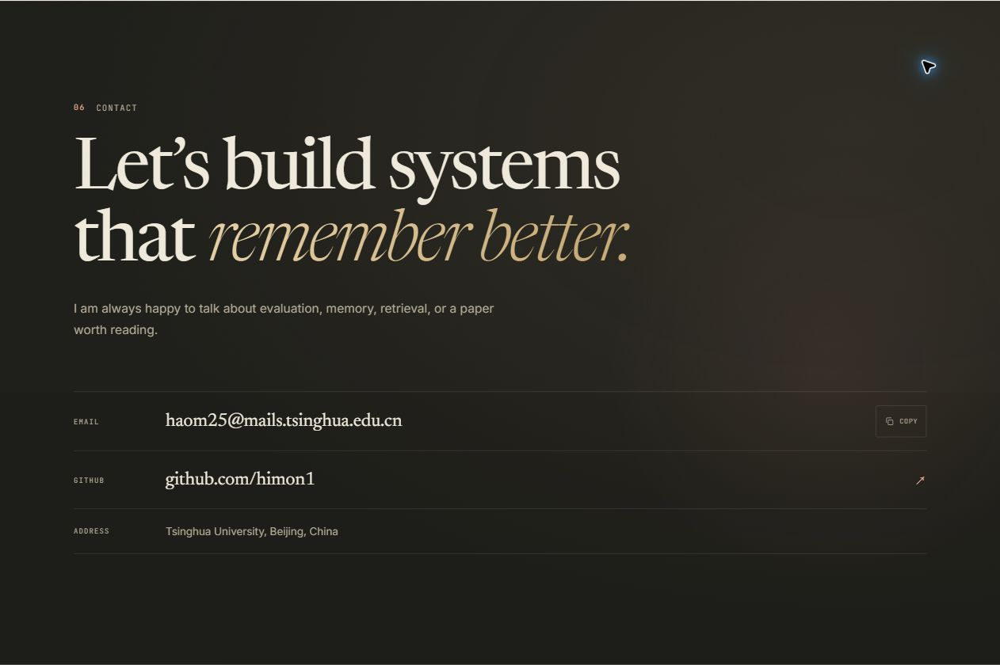

# himon1.github.io

郝木（Mu Hao）的个人学术主页。纯静态、零依赖、零构建：HTML + CSS + 原生 JavaScript，直接由 GitHub Pages 托管。

线上地址：<https://himon1.github.io>

## 设计说明

整体采用「学术索引卡 × 编辑排版」的方向：暖纸底色、衬线大标题、细线网格、印章红与暗金点缀。信息结构遵循主流学术主页的惯例（About / News / Research / Projects / CV / Contact），但视觉与交互做了更精致的处理：

- 中英双语切换（`EN / 中`），偏好保存在 localStorage
- 明暗主题切换，跟随系统偏好，可手动覆盖
- 自托管字体（Newsreader / Inter / JetBrains Mono），不依赖 Google Fonts，国内访问稳定
- 墨色光晕、纸面颗粒、金色描边水印、衬线跑马灯
- 滚动进度、章节导轨、滚动显现、视差、卡片微倾斜与指针光晕
- 响应式布局，支持 `prefers-reduced-motion`，无 JS 时内容仍完整可读
- 姓名只在首屏主标题与页脚版权中出现一次，页头只保留符号标识，避免自我强调

电脑端项目区的材质效果：



## 本地预览

在项目根目录运行任意静态服务器：

```bash
python -m http.server 8000
```

然后打开 <http://localhost:8000>。不要直接双击 `index.html`，`file://` 协议下部分浏览器行为与线上不同。

## 目录结构

```text
.
├── index.html              # 页面内容（中英双语都在这里）
├── 404.html                # GitHub Pages 自定义 404
├── assets/
│   ├── css/style.css       # 全部样式；设计变量集中在 :root
│   ├── js/main.js          # 主题、语言、滚动、复制等交互
│   ├── fonts/              # 自托管 woff2 字体
│   └── img/favicon.svg     # 印章 favicon；og.png 为分享图
├── robots.txt
├── sitemap.xml
└── .nojekyll               # 告诉 GitHub Pages 不要跑 Jekyll
```

## 修改指南

### 1. 文字内容

所有内容都在 `index.html`。双语段落成对出现：

```html
<p>
  <span data-lang="en">English text</span>
  <span data-lang="zh">中文文本</span>
</p>
```

只改其中一种语言也可以；CSS 会自动隐藏当前未选中的语言。若新增段落，记得两段都写，或至少保留英文。

### 2. 新增一条研究经历

复制任意一个 `<article class="research-item …">` 块，修改：

- `data-index`：右侧悬浮的大号编号（如 `04`）
- `.research-no`：左侧小号编号
- `.research-meta`：实验室、时间、状态
- `<h3>` 标题
- 正文与 `.topic-list` 标签
- `<details>` 里的摘要

### 3. 换配色

编辑 `assets/css/style.css` 顶部的 `:root` 与 `html[data-theme="dark"]`：

- `--paper` / `--ink`：纸色与墨色
- `--accent`：印章红
- `--gold` / `--gold-ink`：暗金
- `--serif` / `--sans` / `--mono`：字体栈

### 4. 换头像 / 添加照片

当前主视觉是刻度式同心环与个人概况卡，不依赖照片。环形使用内联 SVG，颜色跟随主题变量；需保持 `.mark` 的边界留白。若要加人像，可在 hero 的概况卡中插入 ``。建议使用 4:5 竖图、小于 300KB 的 WebP。

### 5. 更新简历

简历只作为页面内的 CV 区块展示（教育背景、科研、技能），不提供 PDF 下载或独立页面跳转。直接编辑 `index.html` 中 `#cv` 一节即可。

### 6. 添加博客 / 笔记

推荐独立目录，例如 `notes/`，每篇一个静态 HTML，复用 `assets/css/style.css`，然后在导航中加链接。这样不会破坏主页，也便于单独索引。

## 部署到 GitHub Pages

个人主页仓库必须命名为 `<username>.github.io`。本仓库对应：

```text
https://github.com/himon1/himon1.github.io
```

首次部署：

```bash
git init
git add .
git commit -m "Initial personal site"
git branch -M main
git remote add origin git@github.com:himon1/himon1.github.io.git
git push -u origin main
```

然后在仓库 **Settings → Pages** 中确认：

- Source: `Deploy from a branch`
- Branch: `main` / `/ (root)`

保存后 1–2 分钟即可访问 <https://himon1.github.io>。

> 本机现有 SSH key 已认证为 `himon1`，可直接推送。首次创建仓库后若提示 `Repository not found`，先在 GitHub 网页端创建空仓库 `himon1.github.io`（不要勾选 README），再重新推送。

## 维护约定

- 不改动外部依赖：没有 npm、没有构建步骤，任何编辑器都能改
- 新增交互时先保证无 JS 可用，再渐进增强
- 动效统一使用 `--ease`，并尊重 `prefers-reduced-motion`
- 颜色只从变量取，不在组件里写死色值

## 字体授权

Newsreader、Inter、JetBrains Mono 均采用 SIL Open Font License 1.1，可自托管与再分发。字体文件位于 `assets/fonts/`。

## 版本记录

### 2026-10-22 · 个人介绍与交互细节

- 以电脑端为主要设计与验收对象；保留暖纸、朱红、暗金和原有章节结构。
- 英文姓名统一为 Mu Hao。首屏改为较小的直立衬线姓名、问候语及身份说明，英文不并列中文名；页头去掉 Index。
- 个人概况卡保留随主题变化的纸感，环形细化为刻度、分段弧线和节点，并留出完整边界。
- 跑马灯及项目卡片内容、结构保持原样，新增项目继续复用现有卡片，无须绘制专用图片。
- 调整暗色小字对比、悬停幅度、章节跳转留白、焦点反馈；完善导航、复制反馈及无脚本时的可读性。
- 分享图由 `assets/img/social-card.svg` 维护，PNG 对应 `social-card.png`；旧 `og.png` 保留。
- `Newsreader Upright` 使用现有 `newsreader-italic-latin.woff2`：该文件内置字形实际为 Regular，其文件名沿用原仓库。

### 2026-10-22 · 整页视觉材质与动效

- 细化明暗主题的纸面颗粒、墨色层次、金色边缘、内高光与落影；收淡首屏网格、光晕和水印。
- 修正 Newsreader 正体、斜体的字形映射，使标题与局部斜体形成有意的字体搭配。
- 个人概况卡与项目卡片使用随指针移动的局部金色反光；仅概况卡有小幅度倾斜，文本项目卡不旋转。
- 增加按钮掠光、按下反馈、金色焦点轮廓、联系链接细线与复制成功状态。
- 摘要支持平滑展开和收起；支持时使用原生主题淡化切换，不支持时保持原有切换。
- 动态高光每帧最多更新一次；首屏离开视口后暂停环境动画，遵循系统减少动态效果偏好。
- 本轮保持页面文字、信息结构、项目内容与跑马灯不变，无新增框架或运行依赖。

### 2026-10-22 · 可直接操作的视觉交互

- 去掉环形下方的小字；主环保持静置时 45 秒一圈，增加反向内环。
- 鼠标经过环形时无跳帧加速，按住可直接拖动旋转，松开后从当前角度继续。
- 按钮增加轻微磁吸跟随；项目卡片增加更明确的抬升、局部光泽与随指针移动的金色边缘。
- 首屏鼠标光影与姓名的掠金效果更明显；主题在支持时从点击位置圆形展开，否则使用短淡入。
- 联系区与页脚改为暖墨底、象牙白文字和暗金强调，形成与纸色正文更明显的视觉对比。
- 修正滚动显现样式覆盖项目卡片悬停位移的问题；卡片抬升按实际浏览器状态验证。
- 为样式与交互文件增加资源版本标记，确保重新打开预览时加载本轮效果。
- 仍以电脑端验收，保留已确定的姓名、项目结构、跑马灯与页脚，减少动态效果偏好下关闭新增运动交互。


